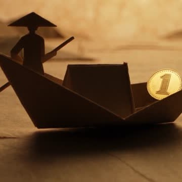
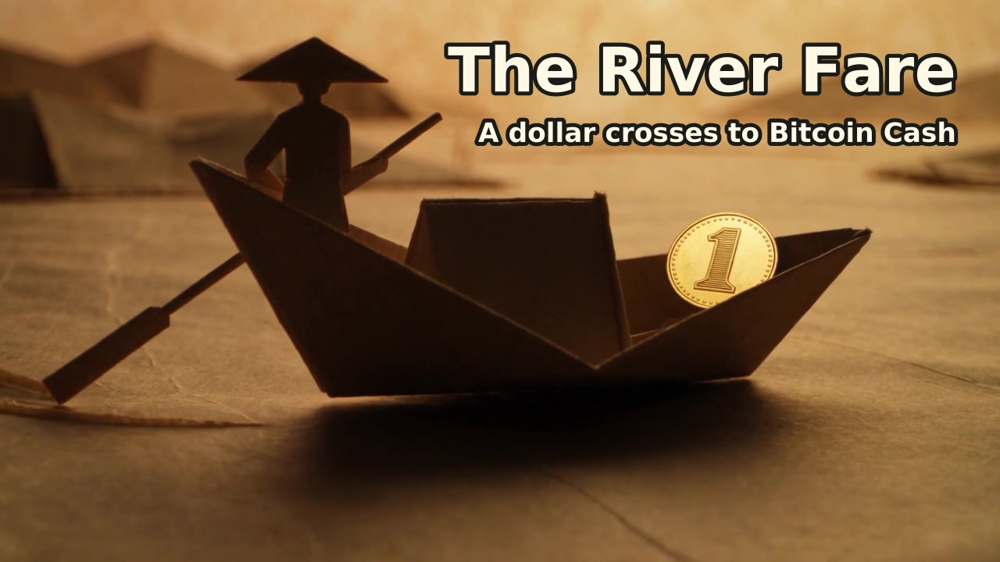
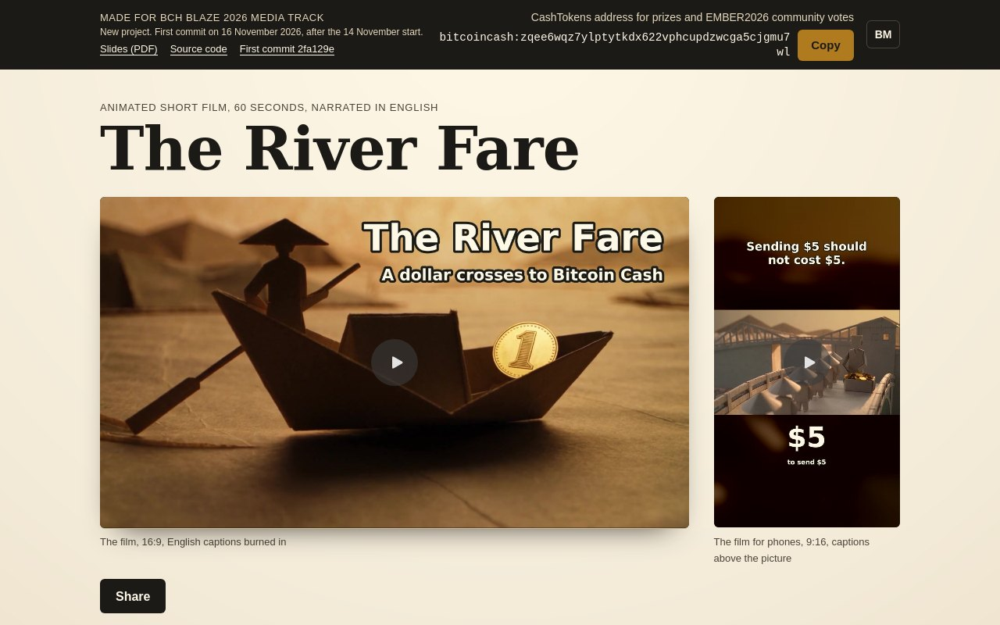

<p align="center"></p>

<h1 align="center">The River Fare</h1>

<p align="center"><a href="https://riverfare.sasateguh.com"></a> <a href="#the-three-files"></a> <a href="LICENSE"></a> <a href="LICENSE"></a></p>

<p align="center"><b>A 60 second paper film: one dollar crosses a river to Bitcoin Cash, and the fare is less than a tenth of a US cent.</b> · <i>Filem kertas 60 saat: satu dolar menyeberang sungai ke Bitcoin Cash, dan tambangnya kurang daripada sepersepuluh sen AS.</i><br>
<a href="https://riverfare.sasateguh.com"><b>watch the film</b></a> · <a href="#try-it-watch-the-film">Try it</a> · <a href="#run-it-rebuild-the-film">Run it</a> · <a href="#tests">Tests</a> · <a href="#limits">Limits</a> · <a href="README.ms.md">Bahasa Melayu</a><br>
Built in Malaysia by <a href="https://aimanmalib.com">Aiman Malib</a> · <a href="https://sasateguh.com">Sasa Teguh</a></p>

## For judges

| Check | Where |
|---|---|
| Watch the film | [On YouTube](https://youtu.be/iyD9a84Wdfw) · [the film page](https://riverfare.sasateguh.com), in English and Malay |
| The fare is real | 219 satoshis: [the transaction on a block explorer](https://bchexplorer.info/tx/9b9586cbd567b0560c3a7d2f2137c244c425582f1ecd378154184eb6186ee588) |
| Prize address | `bitcoincash:zqee6wqz7ylptytkdx622vphcupdzwcga5cjgmu7wl` |
| New project | First commit [`2fa129e`](https://github.com/aimanmalib/sampan-river/commit/2fa129e4c0f61aac3a713878b0a66c69a07b5660) on 16 November 2026, after the 14 November start |
| Where each fact comes from | [The fact list](docs/FACTS.md) |
| What AI made | [AI disclosure](#ai-disclosure) |
| Slides | [English PDF](site/deck/the-river-fare-en.pdf) · [Malay PDF](site/deck/the-river-fare-ms.pdf) |
| Tests | [Offline, no API key](#tests) |

A 60 second animated film made for the BCH BLAZE 2026 Media Track. A toll bridge takes a big coin from
every traveller. A small rower carries one dollar coin across a river to the Bitcoin Cash bank instead, and pays a fare
of less than a tenth of a US cent. English captions are burned into the picture, so it works with the sound off, and a
narrator reads them: an AI clone of the maker's own voice (see the AI disclosure).



## What the film says

Every caption that states a fact is tied to a source in [the fact list](docs/FACTS.md):

- A real Bitcoin Cash transfer on 15 Nov 2026 paid 219 satoshis, less than a tenth of a US cent at that day's price.
- PUSD is a dollar stablecoin token on Bitcoin Cash, designed to hold one dollar.

The end card reads "Get a wallet: Paytaca · Selene". It names two wallet apps for Bitcoin Cash, as each app's own
page describes itself (`wallet-paytaca`, `wallet-selene`, decision 0011). It claims no sponsorship and no PUSD support.

[Storyboard](docs/STORYBOARD.md). [Accepted clips and the seconds used](docs/SHOTS.md).
[Decisions](docs/decisions/).

## Watch

The film on YouTube: https://youtu.be/iyD9a84Wdfw

## Try it: watch the film

Open https://riverfare.sasateguh.com. The page, in English and Malay, plays both films: the 16:9 film and the 9:16 film
for phones, with the prize address and the AI disclosure. The captions are in the picture, so the sound can stay off.



The page is built by `tools/site.py` from the measured files only (decision 0009).
A Share button under the players opens the phone's share sheet, or a panel with copy link, X, WhatsApp and
Telegram, and the 219 satoshi fee links to its transaction on a block explorer (decision 0013). A shared link
shows a vertical preview image made from a film frame by `tools/og.py` (decision 0014). The banner notes that
this is a new project, first committed after the event start, with links to the source and its first commit
(decision 0015). The banner also links a five slide deck, one PDF per language (decision 0016).

## Prize address

bitcoincash:zqee6wqz7ylptytkdx622vphcupdzwcga5cjgmu7wl

## The three files

Measured by `tools/measure.py` on the final files (per-cue detail in [the measurement notes](docs/MEASURED.md)):

| version | size | seconds | loudness | true peak | words heard | captions burned in | sha256 |
|---|---|---|---|---|---|---|---|
| 16:9 | 1920x1080, 24 fps | 60.0 | -14.0 LUFS | -1.4 dBTP | 67 | 10 of 10 cues | `cfff07f1...` |
| 9:16 | 1080x1920, 24 fps | 60.0 | -14.0 LUFS | -1.4 dBTP | 67 | 14 of 14 cues | `1530a180...` |
| 9:16 short | 1080x1920, 24 fps | 18.6 | -14.1 LUFS | -1.5 dBTP | 27 | 8 of 8 cues | `51380201...` |

The short is four segments of the 9:16 film joined with crossfades (decision 0008).

The 9:16 film and the short use the bands above and below the picture (decision 0010): the captions large at the top,
one sourced figure at the bottom. Their cue counts are the captions plus the 4 figures (10 + 4 and 4 + 4).

All are H.264 High with AAC 48 kHz stereo. "Words heard" is a local speech recognition pass over the final audio. All
three files are narrated: the pass must hear the captions read in order (speech match 0.973 on the 16:9 and 9:16
files, 1.0 on the short, at least 0.85 required), and the same picture without the voice is measured as a separate file
with zero words heard, which also shows no stray speech from the video model. The captions are also exported as an SRT file
for closed captions.

## Credits spent

Every request to the video service is written to [log/generations.jsonl](log/generations.jsonl) before it is sent,
with the balance before and after and the file hash. The film used three generations of 9 credits each, 27 credits in
total. One more request failed at the provider and was refunded (0 credits). Portrait clips were not generated: the
credit rule in decision 0001 keeps a reserve for other work, and a portrait request would have gone below it. The 9:16
version is therefore cut from the same landscape clips (decision 0006). A cropped, larger picture was measured and
was too soft against the limit set before measuring, so the full-width picture stays (decision 0007).

## How it is made

| Step | Tool | Config |
|---|---|---|
| Clips (30 s, 1280x720) | `tools/ve.py`, VE Studio text-to-video API | `config/shots.json`, `config/film.json` |
| Credit ledger | `tools/ledger.py` writes `log/generations.jsonl` before every request | `config/film.json` `credits` |
| Captions | burned in from one source file; SRT for closed captions | `config/captions.en.json` |
| Music | `tools/music.py`, original theme synthesised in code (numpy, seeded, byte-identical on every run) | `config/music.json` |
| Audio mix | `tools/mix.py`, music over the clips' own river sound inside the edit windows | `config/music.json` `mix`, `config/shots.json` |
| Narration | `tools/voice.py` reads each caption with the maker's cloned voice; `tools/narrate.py` places the lines | `config/voice.json` |
| Speech check | `tools/transcribe.py`, local faster-whisper with voice activity detection; the narrated files must match the captions, the silent copies must have zero words | `config/film.json` `audio.speech_check` |
| Edit | `tools/edit.py`, ffmpeg: clips scaled with lanczos, end card, burned captions, two-pass loudness | `config/film.json` `edit`, `end_card` |
| Measurement | `tools/measure.py`, ffprobe, ebur128, silence and caption pixel checks | `config/film.json` `measure` |
| 9:16 layout | `tools/layout.py` frame layouts, `tools/sharpness.py` compares a crop with the full-width picture | `config/film.json` `edit.layout`, `measure.sharpness` |
| Thumbnail | `tools/thumb.py`, one film frame with the title drawn by code | `config/film.json` `thumbnail` |
| Share image | `tools/og.py`, a 9:16 cue frame recomposed to 4:5 with the film's own words | `config/site.json` `og_build` |
| Slides | `tools/deck.py` prints `site/deck/deck.html` to one PDF per language with Chromium | `config/site.json` `deck`, lang `deck.*` |
| Film page | `tools/site.py` builds the English and Malay page from measured files only; `deploy/` serves it | `config/site.json`, `site/` |

## Run it: rebuild the film

Python 3 with the packages in `requirements.txt`, and ffmpeg. To repeat a generation you need a VE Studio API key in
`SEEDANCE_API_KEY` (see `.env.example`); every request costs credits and is written to the ledger first:

```
python3 tools/ve.py me
python3 tools/ve.py generate --shot toll-bridge --orientation landscape --out media/clips/toll-bridge-1.mp4
python3 tools/transcribe.py media/clips/toll-bridge-1.mp4
```

Everything after the clips needs no key, only the accepted clips in `media/clips/` and ffmpeg:

```
python3 tools/mix.py --orientation landscape
python3 tools/edit.py 16x9
python3 tools/measure.py 16x9 --write
python3 tools/sharpness.py --write
python3 tools/edit.py 9x16
python3 tools/measure.py 9x16 --write
python3 tools/short.py
python3 tools/measure.py short-9x16 --write
python3 tools/thumb.py
python3 tools/site.py --media media/edit --out public
```

## Tests

The tests run offline, with no API key:

```
python3 -m unittest discover -s tests
```

They cover the credit guard and the ledger, caption timing and the burned-in caption check, the edit and layout
commands, the seeded music, the narration placement, the measurement parser, the film page build in both languages,
the share image, the banner and the slide deck. `tests/test_text.py` holds this README to the fact list: the fare
wording, every satoshi amount, the files table against `docs/MEASURED.md`, the film page address, the narration line
and the end card wallets. `tests/test_readme.py` holds the judge table in both READMEs to `config/site.json`:
the YouTube link, the transaction, the prize address, the first commit and the slide PDFs.

## Limits

- The picture comes from an AI video model; it is not filmed or drawn by hand. The accepted clips and the seconds used
  are listed in [the shot list](docs/SHOTS.md).
- The 16:9 file is 1280x720 clips upscaled to 1920x1080 with ffmpeg, so it is softer than footage made at that size.
- There is no portrait generation: the 9:16 film places the landscape picture at full width with the captions and one
  figure in the bands above and below it (decisions 0006, 0007, 0010).
- The fare figure is one real transfer on 15 Nov 2026 at that day's price ([the fact list](docs/FACTS.md)). It shows
  what that transfer cost, not a fee every transfer will pay.
- The end card names two wallets as examples. Neither sponsors the film, and the film does not say that they support PUSD.
- Rebuilding from the accepted clips is offline and needs only ffmpeg; making new clips needs a paid VE Studio key.

## AI disclosure

- The video clips are generated by an AI video model through the VE Studio API, from the text prompts in
  `config/shots.json`. Every request, its cost and the file hash are in `log/generations.jsonl`.
- The 1920x1080 file is upscaled from 1280x720 clips with ffmpeg (lanczos). The 1080x1920 file places the same clips
  at full width over a blurred copy of the same frame, also with ffmpeg. No AI upscaler.
- The music is synthesised by code written with an AI coding agent. No samples, no AI music service.
- Narration: an AI clone of the maker's own voice (ElevenLabs), reading the on-screen captions.
- Captions, the end card, the thumbnail text and the share image text are drawn by code from `config/captions.en.json`
  and `config/film.json`.
- Direction and review: Muhammad Aiman. Tools: Claude Code.

## License

Code: MIT. Film, music and stills: CC BY 4.0. See [LICENSE](LICENSE).

## Work with Sasa Teguh

I built this project. I run [Sasa Teguh](https://sasateguh.com), a studio in Malaysia that builds websites found on Google and in AI answers, and sets up systems like this one for businesses.

[Book a call](https://sasateguh.com/book) · hello@sasateguh.com · [More from Sasa Teguh](https://github.com/sasateguh)
