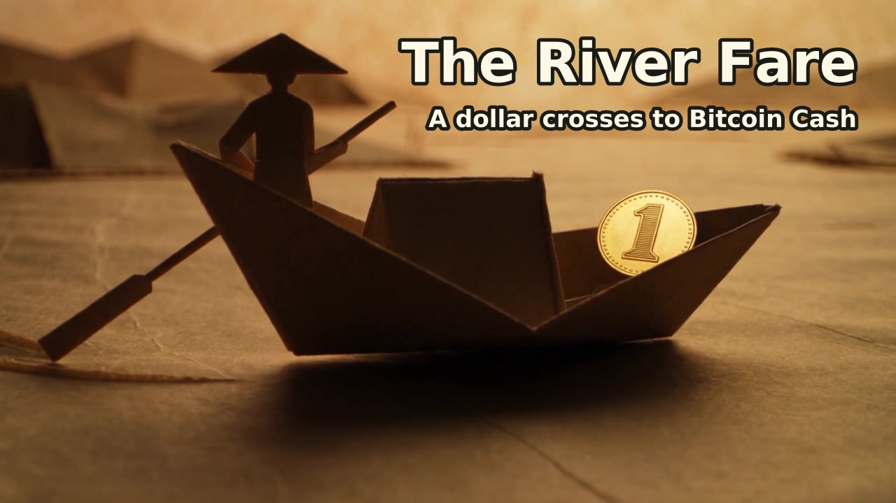
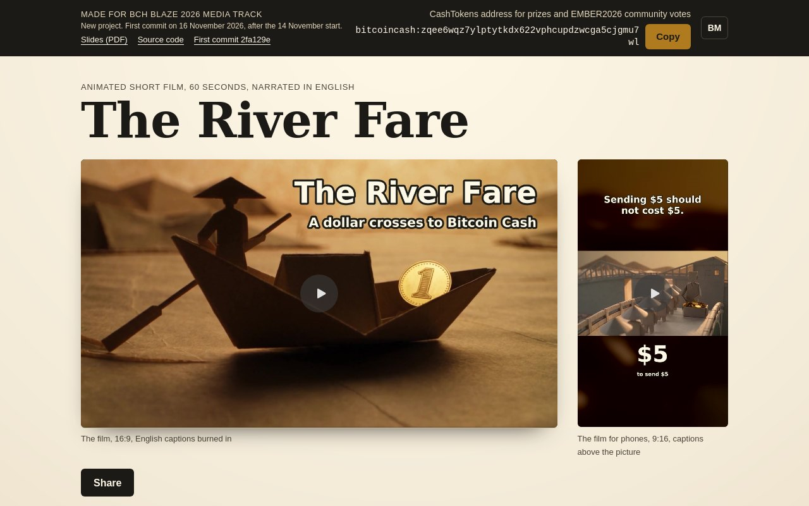

<p align="center"></p>

<h1 align="center">The River Fare</h1>

<p align="center"><a href="https://riverfare.sasateguh.com"></a> <a href="README.md#the-three-files"></a> <a href="LICENSE"></a> <a href="LICENSE"></a></p>

<p align="center"><b>Filem kertas 60 saat: satu dolar menyeberang sungai ke Bitcoin Cash, dan tambangnya kurang daripada sepersepuluh sen AS.</b> · <i>A 60 second paper film: one dollar crosses a river to Bitcoin Cash, and the fare is less than a tenth of a US cent.</i><br>
<a href="https://youtu.be/iyD9a84Wdfw"><b>&#9654;&#xFE0E; filem di YouTube, 60 s</b></a> · <a href="https://riverfare.sasateguh.com">tonton filem</a> · <a href="site/deck/the-river-fare-en.pdf">slaid (PDF Inggeris)</a> · <a href="site/deck/the-river-fare-ms.pdf">slaid (PDF Melayu)</a> · <a href="#untuk-juri"><b>Menilai? Mula di sini</b></a> · <a href="#cuba-tonton-filem">Cuba</a> · <a href="#jalankan-bina-semula-filem">Jalankan</a> · <a href="#ujian">Ujian</a> · <a href="#had">Had</a> · <a href="README.md">English</a><br>
Dibina di Malaysia oleh <a href="https://aimanmalib.com">Aiman Malib</a> · <a href="https://sasateguh.com">Sasa Teguh</a></p>

<p align="center"></p>

## Untuk juri

| Semak | Di mana |
|---|---|
| Tonton filem | [Di YouTube](https://youtu.be/iyD9a84Wdfw) · [halaman filem](https://riverfare.sasateguh.com), dalam Bahasa Inggeris dan Bahasa Melayu |
| Tambangnya benar | 219 satoshi: [transaksi itu di penjelajah blok](https://bchexplorer.info/tx/9b9586cbd567b0560c3a7d2f2137c244c425582f1ecd378154184eb6186ee588) |
| Alamat hadiah | `bitcoincash:zqee6wqz7ylptytkdx622vphcupdzwcga5cjgmu7wl` |
| Projek baharu | Komit pertama [`2fa129e`](https://github.com/aimanmalib/sampan-river/commit/2fa129e4c0f61aac3a713878b0a66c69a07b5660) pada 16 November 2026, selepas acara bermula 14 November |
| Sumber setiap fakta | [Senarai fakta](docs/FACTS.md) |
| Apa yang dibuat AI | [Pendedahan AI](#pendedahan-ai) |
| Slaid | [PDF Inggeris](site/deck/the-river-fare-en.pdf) · [PDF Melayu](site/deck/the-river-fare-ms.pdf) |
| Ujian | [Luar talian, tanpa kunci API](#ujian) |

Ini ringkasan Bahasa Melayu bagi [README.md](README.md). Jadual penuh, alat dan konfigurasi ada dalam versi Inggeris;
jika kedua-duanya berbeza, versi Inggeris yang terpakai.

Filem animasi 60 saat untuk BCH BLAZE 2026 Media Track. Sebuah jambatan tol mengambil syiling besar daripada setiap
pengembara. Seorang pendayung kecil membawa satu syiling dolar menyeberang sungai ke tebing Bitcoin Cash, dan membayar
tambang kurang daripada sepersepuluh sen AS. Sari kata Inggeris dibakar dalam gambar, jadi filem boleh ditonton tanpa
bunyi, dan seorang pencerita membacanya: suara klon AI pembuatnya sendiri (lihat Pendedahan AI).

## Apa yang filem katakan

Setiap sari kata yang menyatakan fakta dipautkan kepada sumber dalam [senarai fakta](docs/FACTS.md):

- Satu pemindahan Bitcoin Cash sebenar pada 15 Nov 2026 membayar 219 satoshi, kurang daripada sepersepuluh sen AS pada
  harga hari itu.
- PUSD ialah token stablecoin dolar di Bitcoin Cash, direka untuk bernilai satu dolar.

Kad penutup berbunyi "Get a wallet: Paytaca · Selene": dua aplikasi dompet Bitcoin Cash, seperti yang diterangkan oleh
halaman setiap aplikasi itu sendiri (keputusan 0011). Filem ini tidak mendakwa ada tajaan atau sokongan PUSD.

## Tonton

Filem di YouTube: https://youtu.be/iyD9a84Wdfw

## Cuba: tonton filem

Buka https://riverfare.sasateguh.com. Halaman itu, dalam bahasa Inggeris dan Melayu, memainkan kedua-dua filem: filem
16:9 dan filem 9:16 untuk telefon, bersama alamat hadiah dan pendedahan AI.



Tonton di YouTube dan Kongsi berada dalam satu baris, di atas pemain 9:16 pada telefon dan di bawah pemain pada
skrin lebar (keputusan 0017). Kongsi membuka helaian kongsi telefon, dan yuran 219 satoshi dipautkan kepada transaksinya di
penjelajah blok (keputusan 0013). Sepanduk memaut kod sumber, komit pertama dan dek lima slaid, satu PDF bagi setiap
bahasa (keputusan 0015, 0016).

## Alamat hadiah

bitcoincash:zqee6wqz7ylptytkdx622vphcupdzwcga5cjgmu7wl

## Tiga fail

Diukur oleh `tools/measure.py` pada fail akhir (butiran dalam [nota ukuran](docs/MEASURED.md)):

| versi | saiz | saat | kekuatan bunyi | puncak sebenar | sari kata dibakar |
|---|---|---|---|---|---|
| 16:9 | 1920x1080, 24 fps | 60.0 | -14.0 LUFS | -1.4 dBTP | 10 daripada 10 |
| 9:16 | 1080x1920, 24 fps | 60.0 | -14.0 LUFS | -1.4 dBTP | 14 daripada 14 |
| 9:16 pendek | 1080x1920, 24 fps | 18.6 | -14.1 LUFS | -1.5 dBTP | 8 daripada 8 |

Ketiga-tiganya mempunyai suara pencerita: semakan pengecaman suara tempatan mesti mendengar sari kata dibaca mengikut urutan, dan gambar
yang sama tanpa suara diukur sebagai fail berasingan dengan sifar perkataan didengar.

## Kredit dibelanjakan

Setiap permintaan kepada perkhidmatan video ditulis ke [log/generations.jsonl](log/generations.jsonl) sebelum dihantar.
Filem ini memakai tiga penjanaan, 9 kredit setiap satu, 27 kredit semuanya. Klip potret tidak dijana kerana peraturan
kredit (keputusan 0001) menyimpan rizab; versi 9:16 dipotong daripada klip landskap yang sama (keputusan 0006).

## Jalankan: bina semula filem

Python 3 dengan pakej dalam `requirements.txt`, dan ffmpeg. Penjanaan klip baharu memerlukan kunci API VE Studio dalam
`SEEDANCE_API_KEY` (lihat `.env.example`), dan setiap permintaan memakai kredit. Semua langkah selepas klip tidak
memerlukan kunci, hanya klip yang diterima dalam `media/clips/` dan ffmpeg:

```
python3 tools/mix.py --orientation landscape
python3 tools/edit.py 16x9
python3 tools/measure.py 16x9 --write
python3 tools/edit.py 9x16
python3 tools/measure.py 9x16 --write
python3 tools/short.py
python3 tools/site.py --media media/edit --out public
```

Senarai penuh langkah dan alat: [README.md](README.md#run-it-rebuild-the-film).

## Ujian

Ujian berjalan luar talian, tanpa kunci API:

```
python3 -m unittest discover -s tests
```

Ujian merangkumi pengawal kredit dan lejar, masa sari kata dan semakan sari kata dibakar, arahan suntingan dan susun
atur, muzik bersemai, penempatan suara, penghurai ukuran, binaan halaman filem dalam dua bahasa, imej kongsi, sepanduk
dan dek slaid. `tests/test_text.py` memastikan README Inggeris sepadan dengan senarai fakta. `tests/test_readme.py` memastikan
jadual juri dalam kedua-dua README sepadan dengan `config/site.json`.

## Had

- Gambar datang daripada model video AI; ia tidak difilemkan atau dilukis dengan tangan.
- Fail 16:9 ialah klip 1280x720 yang dibesarkan ke 1920x1080 dengan ffmpeg, jadi ia lebih lembut daripada rakaman
  bersaiz asal itu.
- Tiada penjanaan potret: filem 9:16 meletakkan gambar landskap selebar penuh, dengan sari kata dan satu angka dalam
  jalur di atas dan di bawahnya (keputusan 0006, 0007, 0010).
- Angka tambang ialah satu pemindahan sebenar pada 15 Nov 2026 pada harga hari itu. Ia menunjukkan kos pemindahan itu,
  bukan yuran yang pasti bagi setiap pemindahan.
- Kad penutup menamakan dua dompet sebagai contoh. Kedua-duanya tidak menaja filem ini.

## Pendedahan AI

- Klip video dijana oleh model video AI melalui API VE Studio, daripada prom teks dalam `config/shots.json`.
- Fail 1920x1080 dibesarkan daripada klip 1280x720 dengan ffmpeg (lanczos). Tiada pembesar AI.
- Muzik disintesis oleh kod yang ditulis dengan ejen pengekodan AI. Tiada sampel, tiada perkhidmatan muzik AI.
- Suara pencerita: klon AI suara pembuatnya sendiri (ElevenLabs), membaca sari kata pada skrin.
- Sari kata, kad penutup dan teks gambar kecil dilukis oleh kod daripada `config/captions.en.json` dan `config/film.json`.
- Arahan dan semakan: Muhammad Aiman. Alat: Claude Code.

## Lesen

Kod: MIT. Filem, muzik dan gambar pegun: CC BY 4.0. Lihat [LICENSE](LICENSE).

## Bekerja dengan Sasa Teguh

Saya membina projek ini. Saya menjalankan [Sasa Teguh](https://sasateguh.com), sebuah studio di Malaysia yang membina laman web
yang ditemui di Google dan dalam jawapan AI, serta menyediakan sistem seperti ini untuk perniagaan.

[Tempah panggilan](https://sasateguh.com/book) · hello@sasateguh.com · [Lagi dari Sasa Teguh](https://github.com/sasateguh)
